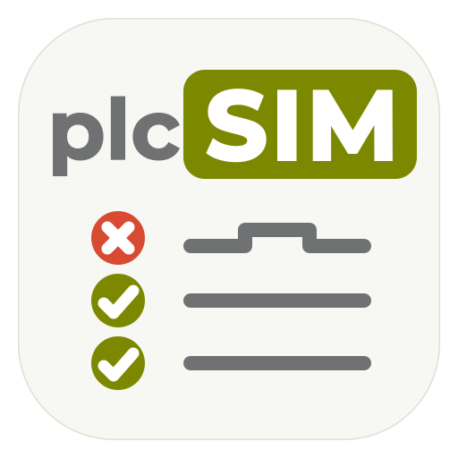
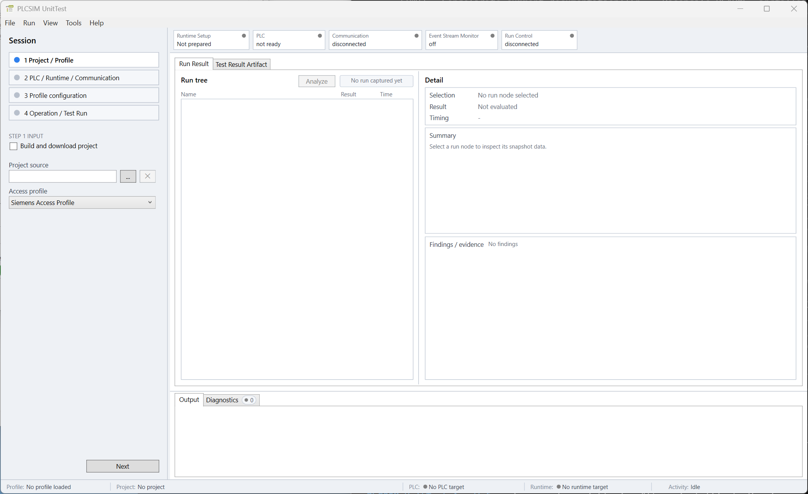
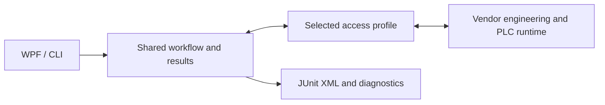

<p align="center">
  
</p>

<h1 align="center">PLCSIM.UnitTest</h1>

<p align="center">
  <strong>PLC unit testing, from engineering to automation.</strong><br>
  One test workflow. A desktop workbench and CLI. Extensible access profiles.
</p>

<p align="center">
  <a href="LICENSE"></a>
  <a href="docs/deployment/windows-installation.md"></a>
  <a href="docs/project-specification.md#technology-stack"></a>
</p>

**Repeatable unit tests for PLC code, from interactive debugging to automated
builds.** PLCSIM.UnitTest executes the tests defined in a PLC project and turns
their events into structured results.

- **Regression testing:** repeat tests after PLC code changes and identify failed assertions.
- **Failure analysis:** retained lifecycle and communication evidence for investigating incomplete or failed runs.

## Desktop Workbench — WPF

- Session configuration, repeated test runs, result inspection and runtime diagnostics.
- Application-managed engineering or testing against a PLC program prepared externally.

<p align="center">
  <a href="src/PLCSIM.UnitTest.App.Wpf/Help/assets/screenshots/application-overview.png">
    
  </a>
</p>

## Automation — CLI

- **PLC tests as a pipeline step:** configured project preparation, transfer and test execution without an interactive UI.
- **A job result CI can act on:** exit codes distinguish successful runs, failed tests and infrastructure errors.
- **Reports retained on failure:** JUnit output remains available for artifact collection and downstream test-report processing.

GitHub Actions job excerpt for a provisioned Windows runner with exclusive access
to its test runtime and the project/configuration already available:

```yaml
runs-on: [self-hosted, Windows, plcsim]
steps:
  - name: Run PLC tests
    shell: pwsh
    run: |
      $results = 'artifacts/plcsim-unittest/${{ github.run_id }}-${{ github.run_attempt }}'
      & 'C:\Program Files\PLCSIM.UnitTest\PLCSIM.UnitTest.App.Cli.exe' run --file .\ci\unittest.json --output "$results/junit.xml"
      exit $LASTEXITCODE
  - name: Retain JUnit report
    if: always()
    uses: actions/upload-artifact@v4
    with:
      name: plc-test-results
      path: artifacts/plcsim-unittest/${{ github.run_id }}-${{ github.run_attempt }}/junit.xml
      if-no-files-found: ignore
```

Each job attempt has its own result path. A failed test fails the execution step;
the upload step still retains the report when one was produced. Uploading stores
the XML artifact; test-report visualization is configured separately in CI.

[Complete CI starters](src/PLCSIM.UnitTest.App.Cli/examples/ci/README.md) include
provisioning guidance, preflight and runtime serialization for

- GitLab CI
- GitHub Actions
- Jenkins
- Azure Pipelines
- TeamCity

## Test Results — JUnit XML

Both applications export reconstructed PLC test results as JUnit XML. Suites,
cases, assertion failures and errors can be consumed by CI test-report views.

Illustrative export with example test names and timings:

```xml
<testsuites name="PLC UnitTests" tests="2" failures="1" errors="0" skipped="0" time="0.035">
  <testsuite name="MotorControl" tests="2" failures="1" errors="0" skipped="0" time="0.035">
    <testcase classname="MotorControl" name="StartMotor" time="0.025" />
    <testcase classname="MotorControl" name="StopMotor" time="0.010">
      <failure message="Motor output remained active">Expected FALSE, observed TRUE.</failure>
    </testcase>
  </testsuite>
</testsuites>
```

## Failure Analysis

- **Run Analysis** links failed assertions and incomplete evidence to affected suites and test cases, separating observed facts, conclusions and suggested checks.
- **Exportable evidence:** a snapshot ZIP contains `analysis.md`, `events.ndjson` and, for run analysis, `hierarchy.json` for further investigation.

Illustrative, shortened Run Analysis for the `StopMotor` failure above:

```text
Run Evidence Analysis
Assessment: Error

[Error] UnitTest failures observed
Observed facts:
  [first-failing-assertion] StopMotor/MotorOutputOff: Expected FALSE, observed TRUE.
Deterministic conclusions:
  [test-result-not-passed] At least one UnitTest owner or finding did not pass.
Suggested checks:
  Inspect assertion 'MotorOutputOff' in test case 'StopMotor'
  and verify its reported actual and expected inputs.
```

[Evidence analysis](src/PLCSIM.UnitTest.App.Wpf/Help/analysis.html) also covers PLC
lifecycle and communication-health reports. Suggested checks are grounded in
retained evidence; they do not assert an unobserved PLC-internal cause.

## Current PLC Targets

| PLC target | Runtime environment | Integration and PLC framework |
| --- | --- | --- |
| **Siemens SIMATIC S7-1500** | Local **PLCSIM Advanced** simulation. | [Siemens profile](access-profiles/siemens/README.md) + [S7UnitTest](https://github.com/Lorenz-Software/S7UnitTest) |
| **Beckhoff TwinCAT 3 PLC** | **TwinCAT 3.1 Build 4026**, existing local **Usermode Runtime**. | [Beckhoff profile](access-profiles/beckhoff-tc3-4026/README.md) + [Tc3UnitTest](https://github.com/Lorenz-Software/Tc3UnitTest) |

**The PC application and the matching PLC framework are both required.** Tests,
assertions and orchestration execute on the PLC.

> [!NOTE]
> The linked framework repositories are currently private and empty while publication is being prepared.

Exact engineering/runtime versions, supported operations and qualification limits
belong to the linked profiles and their bindings.

## Concept And Integration

- **A shared core:** both applications use the same workflow and result model, keeping test interpretation consistent across interactive and automated runs.
- **Access profiles as plugins:** a selected directory package supplies project access, runtime control and UnitTest lifecycle/event communication through common service contracts.
- **Vendor isolation:** engineering and runtime API dependencies stay inside the integration, keeping WPF, CLI and shared result processing independent of vendor types.
- **Independent composition:** Siemens combines TIA Openness and PLCSIM Advanced bindings; Beckhoff integrates TwinCAT engineering and ADS communication in one package. Compatible new profiles extend the available environments.
- **A testable foundation:** the [Fake profile](access-profiles/fake/README.md) exercises the shared workflow without vendor installations.



## Project Status

**Windows distribution 2.0.1:** a FIFO event-buffer fix updates the PLCSIM Advanced
V6/V7/V8 bindings and workers to 2.0.1. The WPF and CLI application remains 2.0.0;
the other component versions are unchanged. See the
[2.0.1 release notes and verification scope](docs/releases/2.0.1.md).

[Download the Windows installer](https://github.com/Lorenz-Software/PLCSIM.UnitTest/releases/tag/v2.0.1).
The [2.0.0 release notes](docs/releases/2.0.0.md) remain available for the previous
distribution.

## Further Reading

- [Technical project specification](docs/project-specification.md): system requirements, technology stack and repository structure.
- [Documentation guide](docs/README.md): installation, WPF/CLI operation, profiles, development and packaging.
- [Architecture](docs/architecture/000-overview.md): shared models and integration boundaries.

## Support this project

Sponsorship helps maintain and improve Lorenz Software's open-source PLC testing
frameworks and tools. [Become a sponsor](https://github.com/sponsors/Lorenz-Software).

## License

Created by **Lorenz Software** and available under the [MIT license](LICENSE).
Distributed third-party components retain their own licenses; see
[release license sources](distribution/licenses/README.md).
