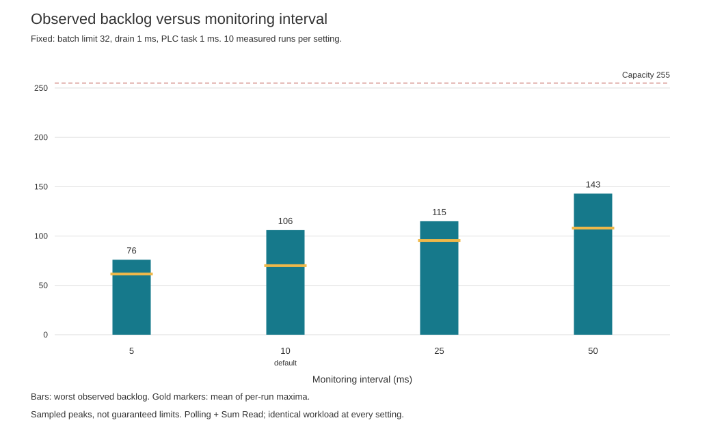
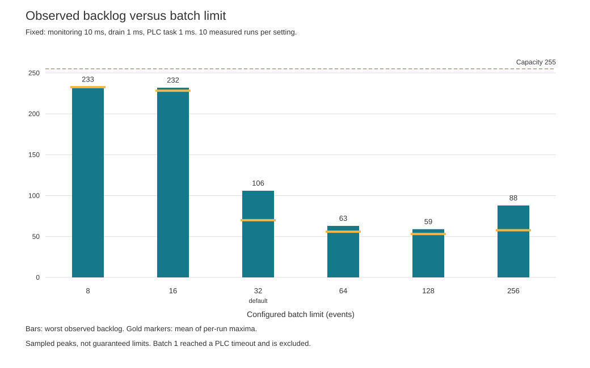
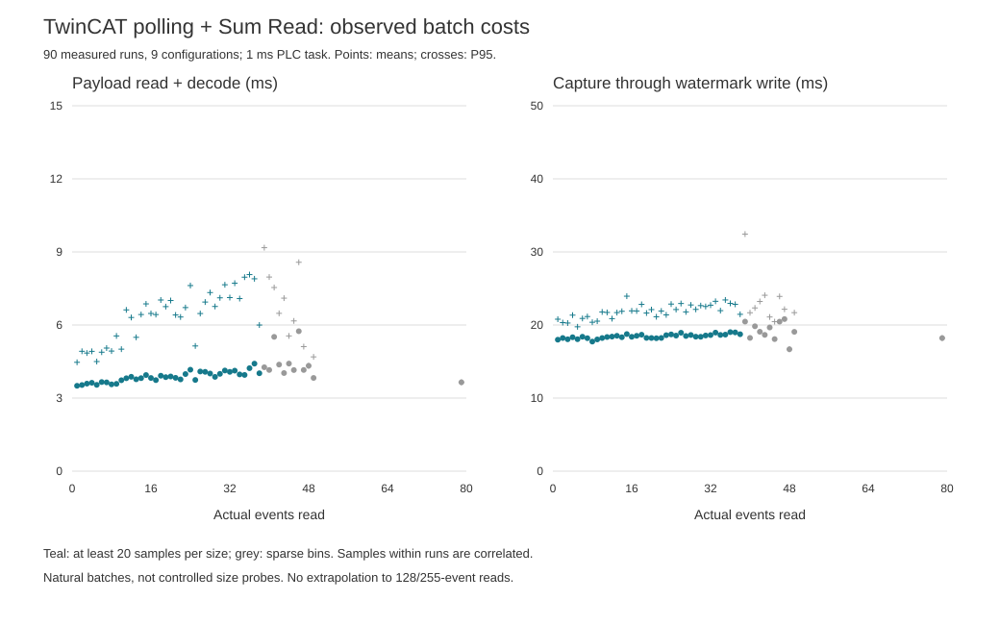

# TwinCAT 3 (4026) EventStream performance

This document characterizes production polling and opt-in subscription with ADS
Sum Read on a local Usermode runtime. It separates communication cost from complete test-run
duration. These are bounded observations, not universal capacity guarantees.
Use the [workload-sizing guide](event-stream-workload-sizing.md) to interpret
event volume, bursts and PLC orchestrator choices.

- [Practical recommendations](#practical-recommendations)
- [Measurement scope](#measurement-scope)
- [Capacity and burst headroom](#capacity-and-burst-headroom)
- [Communication cost](#communication-cost)
- [Observation strategies](#observation-strategies)
- [Resource usage](#resource-usage)
- [Interpretation and limitations](#interpretation-and-limitations)
- [Reproduction and data](#reproduction-and-data)

## Practical recommendations

| Setting | Default |
| --- | ---: |
| Observation strategy | `polling` |
| `monitoringIntervalMs` | `10` |
| `drainIntervalMs` | `1` |
| `maxEventsPerBatch` | `32` |

These defaults remain unchanged. A 5 ms monitoring interval or a batch limit
of 64 can be tested for a particular workload; neither is a generally faster
test-run configuration. Longer monitoring intervals require measured burst
headroom. See the [configuration reference](../configuration.md).

## Measurement scope

### Polling capacity matrix

| Condition | Value |
| --- | --- |
| Measurement date | 2026-10-08 |
| Build | Release, production polling with strict ADS Sum Read |
| Target | Existing local TwinCAT Usermode runtime, PLC port 851 |
| Runtime identity / installed XAE | 3.1.4026 / 3.1.4026.26 |
| ADS dependency | Beckhoff ADS .NET 7.0.389 |
| Workload | SelfTests: 12 serial Suites, 122 Test Cases |
| Healthy run evidence | 1563 run-owned events; 1564 including Start trigger |
| Effective PLC task period | 1 ms |
| Usable EventBuffer capacity | 255 events |
| Drain interval | 1 ms throughout; not swept |
| Repetitions | One separate warm-up and ten measured runs per successful point |
| Logging | Information, raw events off; no synchronous raw-file writes in timed windows |

The [data notes](data/README.md) identify the measured binaries and statistical
boundaries. The same PLC program, Core and profile binaries were used throughout
the final matrix. Nine successful points produced 99 complete runs, of which
90 enter timing statistics. Each had 122 Passed cases, contiguous unique run
events, complete/exportable evidence, zero loss, matching final producer/deleted
counters and verified JUnit output. A batch-limit-1 timeout is reported separately.

Before each run, Reset followed stable completion. Fresh Idle/Ready and empty
buffer evidence preceded the next start. No Abort, CONFIG change or download
was used in the final matrix. Successful run sequences had no warnings/errors;
30 ADS setup/cleanup warnings occurred across the nine series. This is not a
warning-free lifecycle claim.

Configured batch limit and actual events read are different quantities.
Backlog is the maximum observed producer backlog within a run, not a guaranteed
physical peak; averaging these maxima is not a time-average buffer occupancy.
Run duration, payload-read duration, capture duration and process CPU time
describe different boundaries. Capture timing is defined below; statistics
are defined in the [data notes](data/README.md).

## Capacity and burst headroom

All durations below use the PC clock. Capture means the nonempty pre-read
through payload read/decode, post-read, last pre-write check and watermark-write
completion. It excludes subsequent observed PLC deletion, publication and
scheduled waiting. It is not the configured monitoring interval.

### Monitoring interval sweep

Only the monitoring interval changes. **Batch limit 32, drain interval 1 ms**
remain fixed. The 10 ms row is the default reference.

| Monitoring ms | Mean run ms | Run SD ms | Mean run maximum backlog | Worst backlog | Mean capture ms | Mean events/read | Largest read |
| ---: | ---: | ---: | ---: | ---: | ---: | ---: | ---: |
| 5 | 3104.76 | 21.61 | 61.5 | 76 | 17.88 | 18.12 | 32 |
| 10 | 3102.33 | 21.27 | 70.0 | 106 | 18.70 | 19.43 | 32 |
| 25 | 3102.64 | 33.00 | 95.5 | 115 | 18.03 | 21.51 | 32 |
| 50 | 3135.40 | 45.92 | 108.1 | 143 | 18.79 | 23.14 | 32 |

At batch 32, mean run durations at 5, 10 and 25 ms differ by less than 3 ms,
against run standard deviations of 21-33 ms. There is no established whole-run
speed advantage. Lower backlog means additional observed communication headroom,
not proportionally faster PLC test execution.

### Batch limit sweep

Only the batch limit changes. **Monitoring interval 10 ms, drain interval 1 ms**
remain fixed. Batch 32 repeats the same reference population shown above;
it is not an additional measurement series. Both charts use the same backlog scale.

| Batch limit | Mean run ms | Run SD ms | Mean run maximum backlog | Worst backlog | Mean capture ms | Mean events/read | Largest read |
| ---: | ---: | ---: | ---: | ---: | ---: | ---: | ---: |
| 8 | 5116.81 | 70.66 | 232.7 | 233 | 17.72 | 7.96 | 8 |
| 16 | 3458.41 | 62.51 | 228.3 | 232 | 18.31 | 14.66 | 16 |
| 32 | 3102.33 | 21.27 | 70.0 | 106 | 18.70 | 19.43 | 32 |
| 64 | 3110.90 | 19.10 | 55.9 | 63 | 18.54 | 19.62 | 49 |
| 128 | 3115.67 | 40.90 | 53.1 | 59 | 18.81 | 19.36 | 49 |
| 256 | 3111.03 | 40.39 | 57.7 | 88 | 18.43 | 19.31 | 79 |

Batch 64 reduced backlog here, but did not shorten the complete run.
Limits 128/256 did not produce typical
128/255-event reads; the largest actual payload was 79.

### Pressure without overflow

Batch 16 increased mean duration by 11.5%; batch 8 by 64.9% relative to 32.
The buffer-aware PLC orchestrators can wait for free space. Zero lost events
therefore does not prove that communication keeps up without affecting execution.

At batch 1, the first warm-up ended after 38191 ms with PLC Completed/Error and
the framework message `Run Control timeout reached.` Maximum observed backlog
was 233; loss remained zero and all 1470 run-owned events were contiguous.
The buffer drained, but only 109 cases appeared in JUnit, not the healthy 122.
This is an unsuccessful workload completion, excluded from the successful matrix.
It was not repeated. After stable completion and normal Reset, two batch-32
control runs returned to 122 Passed. No EventBuffer reset was necessary.

## Communication cost

Sum Read groups FIFO control, status and delete-request metadata into one ADS
request. It does not imply an atomic PLC snapshot. Per-item failures, exact
response lengths, post-read validation and the final pre-write check remain
enforced; payload/release order and polling scheduling are unchanged.

Against a fresh matched-Core polling reference at 10/1/32, mean capture cost
fell from 32.85 to 18.70 ms (about 43%). Complete-run duration fell from
3254.29 to 3102.33 ms (about 4.7%). These are different measurements; the latter
also depends on PLC orchestration. Actual batch-size distributions differ, so
this comparison is not an equal-size payload microbenchmark.

### Duration versus actual events read

The following bins pool 8517 nonempty captures from the 90 measured runs.
Payload duration includes decoding; those two costs were not instrumented
independently. P95 is a nearest-rank sample percentile.

| Actual events | Samples | Mean payload ms | Payload P95 ms | Mean capture ms | Capture P95 ms |
| ---: | ---: | ---: | ---: | ---: | ---: |
| 1 | 136 | 3.50 | 4.47 | 17.99 | 20.79 |
| 8 | 2028 | 3.56 | 4.93 | 17.73 | 20.38 |
| 16 | 957 | 3.82 | 6.47 | 18.39 | 21.94 |
| 32 | 1149 | 4.08 | 7.13 | 18.62 | 22.71 |

Natural batches are not controlled size probes. The chart marks bins with fewer
than 20 samples as sparse; size 79 has only one observation. The pooled linear
fits explain little variation: payload R-squared 0.028, capture 0.020;
individual-configuration payload fits remain at or below 0.0374. Neither a
predictive per-event slope nor a fixed-cost intercept is justified. A nonlinear
fit solely to improve the training score would not resolve this limitation.
No extrapolation to 128/255 events is made.

## Observation strategies

### Polling versus subscription

A separate matched production comparison on 2026-10-09 used the same workload,
1 ms PLC task and 10/1/32 settings, with current identical Core/profile binaries
for both strategies. Each had one excluded warm-up and ten measured runs.
For polling, 10 ms is the idle wait after processing; for subscription, it is
the ADS OnChange sampling interval. It is not an added processing delay.
Both EventBuffer and RunControl used the selected strategy.

| Measurement | Polling + Sum | Subscription + Sum |
| --- | ---: | ---: |
| Mean complete run, ms | 3087.31 | 3070.55 |
| Mean nonempty capture through watermark write, ms | 17.77 | 16.88 |
| Capture P95, ms | 20.93 | 19.91 |
| Mean events per capture | 18.93 | 14.06 |
| Mean run-maximum observed backlog | 60.1 | 39.2 |
| Worst observed backlog | 73 | 45 |
| Mean process CPU, ms/run | 325.00 | 271.88 |
| Mean process allocation, MiB/run | 14.06 | 15.88 |
| Mean RunControl reads/run | 197.8 | 31.0 |
| Mean EventBuffer callbacks/run | 0 | 224.9 |
| Mean RunControl callbacks/run | 0 | 3.0 |
| Mean nonempty batches/run | 82.6 | 111.2 |

All 22 runs, including warm-ups, had 122 Passed cases, complete/exportable
evidence, 1563 contiguous unique run events, no loss/duplicate delivery and
confirmed final empty state with producer=deleted. The polling matrix above
is a separate population; do not mix its numbers with this comparison.

Subscription reduces RunControl polling and observed backlog here. It drains
earlier in smaller batches, increasing batch count and allocation. The complete
run changes by only about 0.5%; PLC orchestration still dominates. Capture means
compare different actual batch-size populations, not identical payload sizes.
This supports opt-in subscription for lower idle/read load or additional burst
headroom, not a universal throughput guarantee or a new default.

During five-second startup-adjacent idle samples, RunControl performed 322 versus
46 reads, with 212 versus 45 EventBuffer logical pre-reads. Process allocation
was 3,376,536 versus 790,504 bytes. The short samples precede warm-up and can
include startup/JIT effects; they are not steady-state CPU benchmarks.
Active-run CPU/allocation include SDK, Core and passive harness instrumentation.
Callbacks were counted on production clients without extra subscriptions; their
counts are not isolated callback CPU cost. A logical EventBuffer pre-read may
use cached metadata or an explicit Sum Read, so these counts are not ADS packet
counts. Read consistency and final-empty checks remain explicit.

External STOP/RUN, reconnect and short/long CONFIG/RUN restored actual callbacks
and complete follow-up runs. CONFIG cleanup diagnostics and PLC startup reset
timeouts also occurred in the polling control and remain a separate unresolved
finding; see [qualification](../verification.md#subscription-qualification).
Do not interpret successful later runs as a healthy initial startup.

The compact [strategy summary](data/strategy-summary.csv) retains this comparison;
the [data notes](data/README.md) identify its binaries and measurement boundaries.

## Resource usage

At monitoring 5/10/25/50 ms and batch 32, mean process CPU time was
318.75/289.06/237.50/204.69 ms per run. Run-to-run CPU SD was roughly
86-112 ms. Cumulative allocation was 14.50/13.84/12.89/12.16 MiB per run.
These measurements include harness, Core and vendor-library work on a
16-logical-processor host. They are neither driver-only CPU cost nor retained
memory/working-set measurements. Idle CPU was not measured in that matrix. They do not justify
raising the default interval for unknown workloads.

## Interpretation and limitations

- Backlog maxima are sampled observations, not guaranteed physical peaks.
- Ten runs describe this sample, not rare-event probabilities; run-level P95
  is the maximum at this sample size. Within-run captures are correlated.
- Settings were measured sequentially, not as a randomized factorial experiment.
- The observed end condition has approximately 5 ms harness-check granularity.
- Scheduled waits and PLC deletion observation are not pure ADS response time.
- No remote target, Kernel runtime, other task period, error-heavy workload or
  numeric parallel/slotted-orchestrator capacity was qualified by this matrix.
- Subscription is qualified for the stated local fixture, not for remote/kernel
  targets or a complete interval/batch sweep. Its comparison is separate from
  the polling-only matrix and fitted-cost discussion.
- Siemens measurements use a different workload and orchestration. Their event
  counts, fitted costs and backlog ratios are not TwinCAT capacity estimates.

### When to repeat measurements

For a new workload, establish a healthy baseline with fixed program/build,
task period and logging, then vary one setting at a time. Include a separate
warm-up and at least ten measured complete runs; retain failed attempts
separately. Check result completeness and release progress before interpreting
speed. Compact CSVs and regenerable SVGs are retained here; raw logs and live
harnesses are not release artifacts.

## Reproduction and data

- [Data sets, binary identity, statistics and diagram regeneration](data/README.md)
- [Run-level capacity measurements](data/run-measurements.csv)
- [Capacity summary](data/configuration-summary.csv)
- [Actual-size read summary](data/read-size-summary.csv)
- [Matched strategy comparison](data/strategy-summary.csv)

The diagrams in `diagrams/` can be regenerated offline using the script linked
from the data notes. Temporary live harnesses and raw logs are not packaged.
Natural payload reads include decoding; complete captures additionally include
metadata checks and watermark-write completion. They are neither controlled
payload probes nor complete test-run durations.
