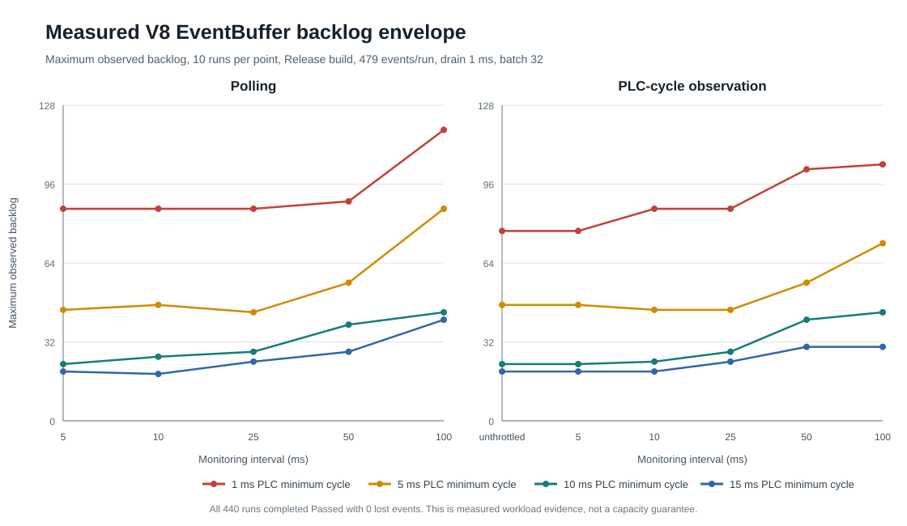
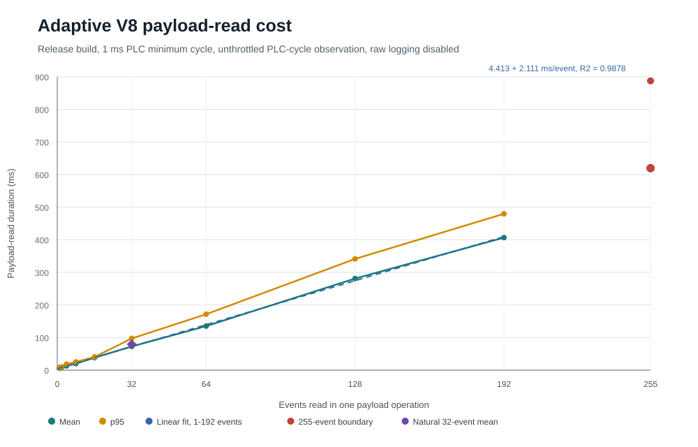

# PLCSIM Advanced V8 EventStream performance

This document characterizes the current adaptive PLCSIM Advanced V8
EventStream reader. It combines a normal-run capacity matrix with a controlled
payload-read microbenchmark. The results are bounded observations for the
measured machine and workload, not universal capacity guarantees.

Use the version-neutral
[EventStream workload-sizing guide](../../../docs/performance/event-stream-workload-sizing.md)
to estimate event volume and burst concentration before applying the V8 data.

- [Practical recommendations](#practical-recommendations)
- [Measurement scope](#measurement-scope)
- [Capacity and burst headroom](#capacity-and-burst-headroom)
- [Communication cost](#communication-cost)
- [Observation strategies](#observation-strategies)
- [Resource usage](#resource-usage)
- [Interpretation and limitations](#interpretation-and-limitations)
- [Reproduction and data](#reproduction-and-data)

## Practical recommendations

The Siemens profile defaults remain:

| Setting | Default |
| --- | ---: |
| Observation strategy | `polling` |
| `monitoringIntervalMs` | `10` |
| `drainIntervalMs` | `1` |
| `maxEventsPerBatch` | `32` |

Use a 5 ms monitoring interval when burst tolerance matters more than worker
cost. Use 25 ms only for a known, bounded workload with measured headroom.
The measured 50 and 100 ms points establish evidence for this workload but are
not recommended defaults for unknown bursts. Unthrottled `plcCycle` observes
every usable PLC cycle and is an explicit high-frequency option, not the
general default.

Select `polling` or `plcCycle` for the required observation semantics. The
matrix does not establish a general capacity advantage for either strategy.

## Measurement scope

The Release matrix contains 44 points and ten complete runs per point. All
440 runs completed with a PLC-side `Passed` result, exactly 479 delivered
events, and zero lost events.

| Condition | Value |
| --- | --- |
| Build | Compiler-optimized Release |
| UnitTest workload | 10 Suites, 51 Test Cases, 479 events |
| PLC minimum cycle settings | 1, 5, 10, and 15 ms |
| Polling intervals | 5, 10, 25, 50, and 100 ms |
| PLC-cycle intervals | unthrottled, 5, 10, 25, 50, and 100 ms |
| Drain and batch settings | 1 ms / 32 events |
| Recorded EventBuffer length | 256 |
| Raw EventStream logging | Disabled |
| Concurrent TIA/WPF/CLI communication | None |
| Contract and framework | 1.0.0 / 1.0.0 |

The workload used serial Suite orchestration. Its event volume and structure
are a calibration point, not a general workload definition.

Configured batch limit and actual events read are different quantities.
Backlog is the maximum observed producer backlog within a run, not a guaranteed
physical peak; averaging these maxima is not a time-average buffer occupancy.
Run duration, payload-read duration and worker CPU time describe different
boundaries. Payload timing is defined below; statistics are defined in the
[data notes](data/README.md).

## Capacity and burst headroom

Across all 44 points, maximum observed backlog ranged from 19 to 118 entries.
The strongest backlog occurred with a configured 1 ms PLC minimum cycle and
100 ms polling. Slower PLC minimum cycles reduced burst concentration for this
program.

| PLC minimum cycle | Lowest point maximum | Highest point maximum |
| ---: | ---: | ---: |
| 1 ms | 77 | 118 |
| 5 ms | 44 | 86 |
| 10 ms | 23 | 44 |
| 15 ms | 19 | 41 |

The default polling configuration produced:

| PLC minimum cycle | Mean run duration | Mean backlog | Maximum backlog | Mean worker CPU per run |
| ---: | ---: | ---: | ---: | ---: |
| 1 ms | 1816.9 ms | 73.8 | 86 | 615.6 ms |
| 5 ms | 2880.9 ms | 36.0 | 47 | 846.9 ms |
| 10 ms | 5070.3 ms | 22.6 | 26 | 1215.6 ms |
| 15 ms | 7314.7 ms | 18.1 | 19 | 1557.8 ms |



The source of record is the
[run-level table](data/real-runtime-capacity-runs.csv). The
[point summary](data/real-runtime-capacity-summary.csv) derives the values used
by the diagram and tables.

## Communication cost

### Controlled payload-read cost

The payload microbenchmark used the same production adaptive reader through a
separately compiled measurement worker. It used Release binaries, a configured
1 ms PLC minimum cycle, unthrottled `plcCycle`, a 1 ms drain interval, and raw
EventStream logging disabled.

The operating-range linear model covers controlled batches from 1 through 192
events:

```text
EntryReadDurationMs = 4.413 ms + 2.111 ms/event
R2 = 0.9878
RMSE = 14.92 ms
```

The linear model was retained after comparison with quadratic and offset-power
models. Those models improved training fit only marginally and generalized
worse when one complete batch size was held out.

| Events | Mean payload read | p95 payload read |
| ---: | ---: | ---: |
| 1 | 6.94 ms | 8.60 ms |
| 2 | 8.79 ms | 10.00 ms |
| 4 | 13.34 ms | 18.52 ms |
| 8 | 20.01 ms | 25.19 ms |
| 16 | 38.34 ms | 40.55 ms |
| 32 | 72.91 ms | 97.28 ms |
| 64 | 135.26 ms | 171.73 ms |
| 128 | 281.12 ms | 341.32 ms |
| 192 | 406.82 ms | 479.70 ms |
| 255 boundary | 619.72 ms | 887.62 ms |

The observed 255-event saturation point in this fixture, configured with an
default EventBuffer length of 256 (255 usable FIFO entries), is intentionally excluded from the operating-range
fit. Its higher cost and variance make it a boundary observation, not a normal
batch-sizing target or a fixed consumer capacity. Other PLC projects may
configure a different EventBuffer length.



Controlled 32-event reads measured 72.91 ms mean and 97.28 ms p95. Naturally
occurring 32-event reads measured 79.54 ms mean and 178.83 ms p95. Their similar
central tendency supports the controlled measurement, while the natural
samples show materially greater variance.

Pre- and post-metadata reads averaged approximately 0.38 to 0.52 ms each. Other
measured snapshot overhead remained approximately 4.76 to 5.65 ms. Release
roundtrip, scheduling, publication, and complete-drain time are excluded from
the payload regression.

The stable [payload summary](data/event-payload-read-summary.csv) and
[individual samples](data/event-payload-read-samples.csv) own the published
values.

## Observation strategies

The measured strategies are `polling` and `plcCycle`. Polling uses the
monitoring interval between idle observations; `plcCycle` uses sync events,
optionally limited by a configured minimum interval. Unthrottled `plcCycle`
does not add a monitoring delay. Both retain active draining.

The capacity diagram separates strategies into panels and PLC minimum cycle
settings into labelled curves. Within each curve only the monitoring interval
changes; drain interval and batch limit remain fixed. The matrix does not
establish a general capacity advantage for either strategy. Subscription is
not supported by this binding.

## Resource usage

Worker CPU values are process observations over runs with different elapsed
durations. They are not individual Runtime API call costs and should not be
compared without considering run duration.

The default-configuration table above reports mean worker CPU per run. This
campaign does not establish isolated callback costs or managed-allocation
comparisons between strategies. Retained source data also contains process
private-memory deltas; these are not retained-object measurements.

## Interpretation and limitations

The capacity matrix and payload microbenchmark answer different questions:

- The capacity matrix observes complete runs with continuous draining and a
  fixed maximum batch size of 32.
- The microbenchmark deliberately creates controlled backlog and measures one
  payload-read operation at a requested size.

Large measured batches are expensive because the V8 API path still performs
per-event string reads. Increasing `maxEventsPerBatch` can therefore retain a
larger prefix for longer and is not automatically a throughput improvement.
The current data supports the 32-event default; it does not compare alternative
drain intervals or prove that 32 is optimal for every workload.

The following influences were not measured and have no quantified claim:

- raw EventStream logging;
- concurrent TIA Portal online observation or download activity;
- concurrent WPF or CLI sessions;
- different host hardware, Runtime API builds, or EventBuffer lengths;
- non-serial orchestration or substantially different test timing;
- sustained soak behavior.

Validate the final PLC program on its intended runtime. Require zero lost
events and evaluate maximum backlog, not only successful Run Control completion.

### When to repeat measurements

Repeat the capacity matrix when the maintained PLC calibration program changes
materially, especially after adding enough Suites, Test Cases, preparation
paths, or expected findings to alter its event fingerprint or burst shape.
Additional qualification should also be considered before publishing guidance
for a different host, Runtime API update, EventBuffer layout, batch/drain
configuration, or orchestration pattern.

A future workload does not invalidate this bounded data set. Record it as a new
measurement boundary, retain its own structural fingerprint, and compare it
without combining samples from different PLC programs into one statistical
population.

## Reproduction and data

- [Data sets, measurement identity and statistics](data/README.md)
- [Run-level capacity measurements](data/real-runtime-capacity-runs.csv)
- [Capacity summary](data/real-runtime-capacity-summary.csv)
- [Payload samples](data/event-payload-read-samples.csv)
- [Payload summary and fit membership](data/event-payload-read-summary.csv)
- [Measurement tooling and build switches](../../tests/performance/README.md)

The diagrams in `diagrams/` visualize the retained data. Raw worker logs and
temporary experiments are not part of this documentation. Controlled payload
read duration excludes metadata checks, release roundtrip, publication and
scheduled waiting; do not equate it with a complete capture or test-run duration.
